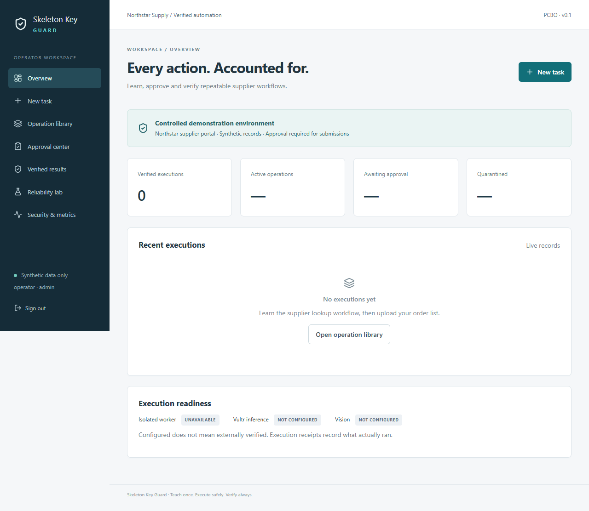

# Skeleton Key Guard

**Teach once. Execute safely. Verify always.**

A working-code implementation of a controlled supplier-portal automation platform.
It learns restricted read workflows, validates immutable versions, requires exact
approval for writes, and checks outcomes against persisted portal records.

This repository is independently written. The general browser-to-reusable-tool idea
was informed by [Skeleton Key](https://github.com/Carldtitan/skeleton_key); no source
code, logos or assets from that project were copied. The working project name is not
a claim of affiliation or trademark clearance.

## Run

See [deployment instructions](docs/deployment.md) for Docker/WSL and Vultr setup.

```bash
python infra/scripts/setup_env.py
# Configure actual Vultr key/model identifiers in .env.
sudo bash infra/scripts/network.sh
docker build -f infra/docker/browser.Dockerfile -t skg-browser:local .
docker compose up -d --build
```

Open **http://localhost:8080**. The generated .env holds your operator password.
Do not commit credentials. Without Vultr configuration learning reports unavailable;
there is no fake AI fallback.

In the completed local workspace, the Docker stack is already running at that URL.
Sign in as `operator` using `OPERATOR_PASSWORD` from the private `.env` file.
Its database contains explicitly labeled test-fixture operations from acceptance
testing, so you can inspect real browser evidence and exercise approval-controlled
submissions without making a model call. Fresh learning and automatic repair require
the actual Vultr configuration. The portal is currently on layout v2 after the repair test.

## Development checks

```bash
python -m venv .venv
# Windows: .venv/Scripts/python; Linux: .venv/bin/python
python -m pip install -e '.[test]'
python -m pytest -q
cd apps/web
npm ci
npm run build
```

Activate your virtual environment before the pip/test commands. Frontend-only
development uses `npm run dev`, with API proxy to localhost:8000. Browser jobs still
require the isolated worker; no unsandboxed application fallback is provided.

## What is in the repository



- React/TypeScript console: overview, CSV upload, live timeline, operation library,
  approvals, results, reliability scenarios and real-run measurements.
- FastAPI control plane, PostgreSQL schema/migration, sessions and CSRF protection.
- 24 persistent synthetic supplier orders, two portal layouts and failure scenarios.
- Vultr inference adapter, restricted action proposals and compilation, versioned
  candidates, regression checks and held-out cases, bounded repair.
- Docker supervisor and Playwright interpreter with a fixed action vocabulary.
- Exact snapshot approvals, single-use consumption, durable idempotency and reconciliation.
- Independent verification, screenshots, receipts and CSV/JSON exports.
- Tests, deployment assets, threat model and hackathon presentation materials.

## Evidence and limits

Read [verification-report.md](docs/verification-report.md) for exactly what was run,
what passed and what remains externally unverified. Code presence is not evidence
that cloud deployment, real-model learning or container hardening was validated.

This product intentionally supports one controlled synthetic portal. It does not
support arbitrary websites, real supplier credentials, public guest writes, or
enterprise tenant isolation. Both two-VM production resources and a single-VM
development/fallback layout are included; cloud deployment is not yet verified.

## Documentation

- [Architecture](docs/architecture.md)
- [Permission contracts](docs/operation-contracts.md)
- [Threat model](docs/threat-model.md)
- [API](docs/api.md)
- [Deployment](docs/deployment.md)
- [Measurements](docs/benchmarks.md)
- [Demo and submission material](docs/demo-script.md)
- [Limitations](docs/limitations.md)

Original source is MIT licensed. Dependencies retain their own licenses.

See [completion and handover](docs/completion-checklist.md) for the requirement map and remaining live-provider/deployment steps.

For an already-built Windows/Ubuntu WSL installation, run
`powershell -File infra/scripts/local.ps1 -Action start` from this folder. Use
`-Action status` to inspect services and `-Action stop` to stop them without deleting data.
Security & metrics includes a provider setup panel; the explicit live inference
test uses tokens and remains unavailable until you privately configure Vultr.

## User signup and login

Open http://localhost:8080 and select **Create a new account**. Choose a lowercase
username and a password of at least 12 characters, confirm it, and select **Create
account**. Signup signs you in automatically; use **Sign out** and **Sign in** for
later sessions. Operator accounts use the same sign-in form.

New users can run read-only supplier checks and access their own task histories.
Supplier submissions are limited to controlled operators; workflow administration
remains admin-only. Signup does not grant paid inference or administrative access.


## Priority improvements

- New task includes sample orders and checks current worker/operation readiness.
- Transient reads retry once. Access denials, policy blocks, missing evidence and
  confirmed portal changes are shown separately; writes are never blindly replayed.
- Failed reads link directly to repair evidence, candidate definitions, contract
  changes, regression results and promotion/rejection reasons.
- Security & metrics provides bounded paired baseline/reuse benchmarks with real
  inference usage, initial learning cost, failures, median/p95 and raw exports.
- [Hackathon readiness](docs/hackathon-readiness.md) maps the implementation to
  official requirements and provides a real-provider acceptance command. Cloud
  hosting, actual AI/vision runs and recorded submission assets remain pending.
