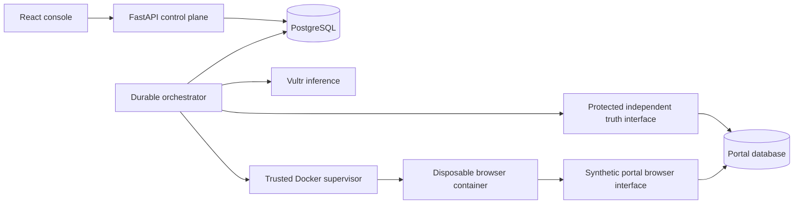

# Architecture and implementation choices

The worker takes fixed schema-validated jobs. It cannot receive arbitrary images,
commands, mounts or resource settings from the client. Only the supervisor has
Docker socket access. The API, inference service and portal admin are absent from
the browser execution network.
The <=64 KiB synthetic job definition is passed as JSON in the container environment
and removed from the runner environment on startup. It contains inputs and permitted
steps, never infrastructure credentials. This avoids ambiguous Docker stdin EOF
behavior. The Docker administrator can inspect synthetic job inputs.

Learning replays an increasingly long, bounded prefix in fresh browser containers.
Actual page targets and text feed Vultr inference; its proposed action passes the
same deterministic policy as reusable execution. The read prefix is compiled by
the model, validated on regression and held-out orders, and persisted immutably.
This replay design deliberately prioritizes inspectability over learning speed.

Only three business operations exist. Preparation is a trusted local operation.
Read discovery is AI driven. Write definitions are deterministic composition of the
validated read prefix plus the fixed permitted request form. They require explicit
operator review, and each invocation separately requires exact human approval.
There is no claim that write workflows are autonomously learned or automatically
tested with real mutations.

The controlled portal's protected backend supplies independent truth. The runner
cannot access that listener. Missing data, unknown orders and verification failures
are distinct states. Screenshot evidence supports checks but cannot substitute for
persisted order/message equality.

Jobs use transactional claims, expiring leases and heartbeats. MVP deployment runs
one orchestrator. Expired executions are marked interrupted/uncertain, never
blindly replayed. The worker has a separate expired-container reaper.

SQLite is supported for local unit tests; PostgreSQL is the deployment database.
The synthetic portal uses its own persistent SQLite file with two service processes.
Do not expose either the worker or portal-admin listener publicly.

Source layout is deliberately flatter than the suggested outline: `guard/`,
`worker/`, `runner/`, `portal/`, `apps/web/`. This avoids empty abstractions while
preserving deployable service boundaries.
